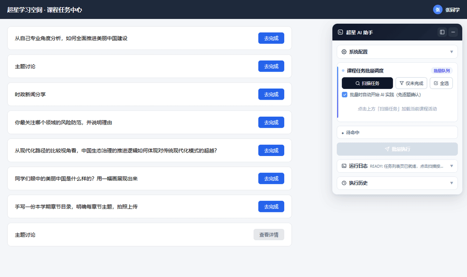
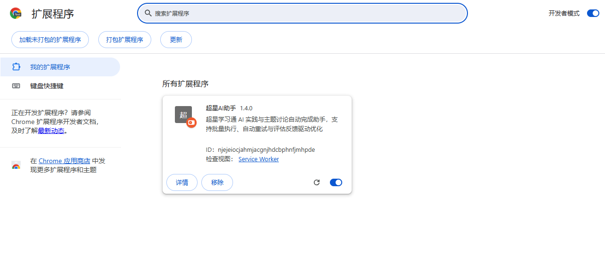
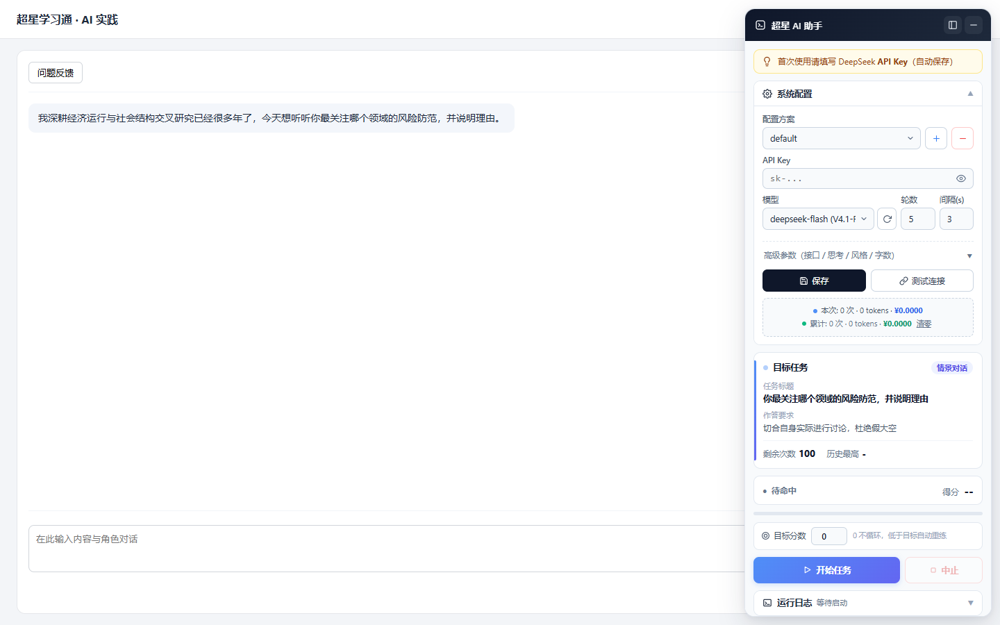
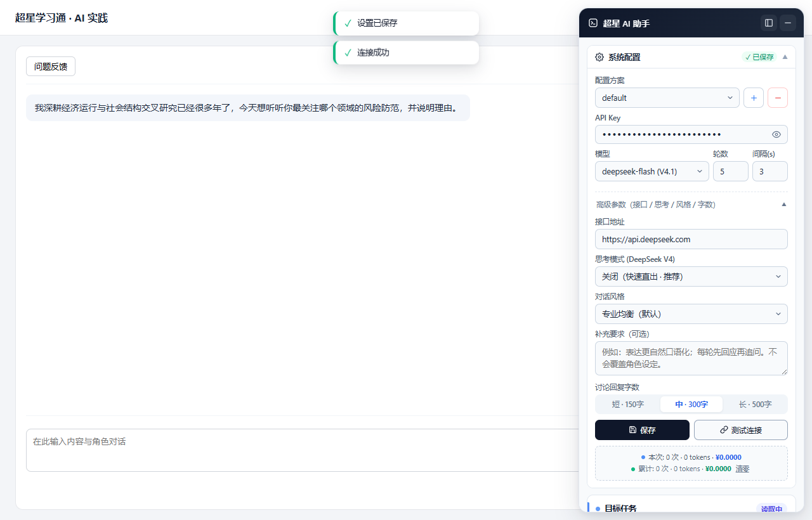
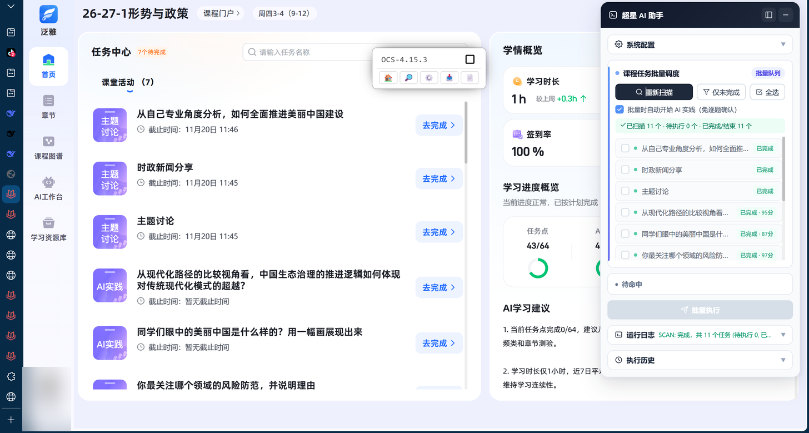
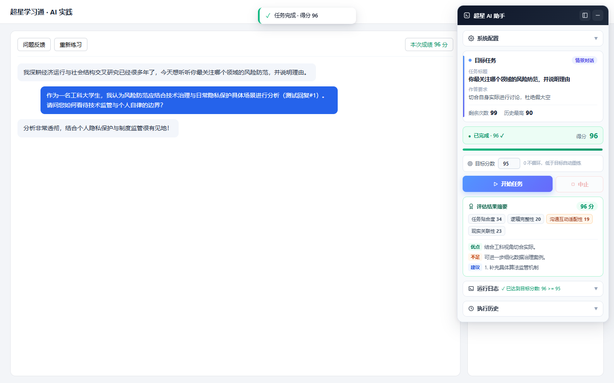
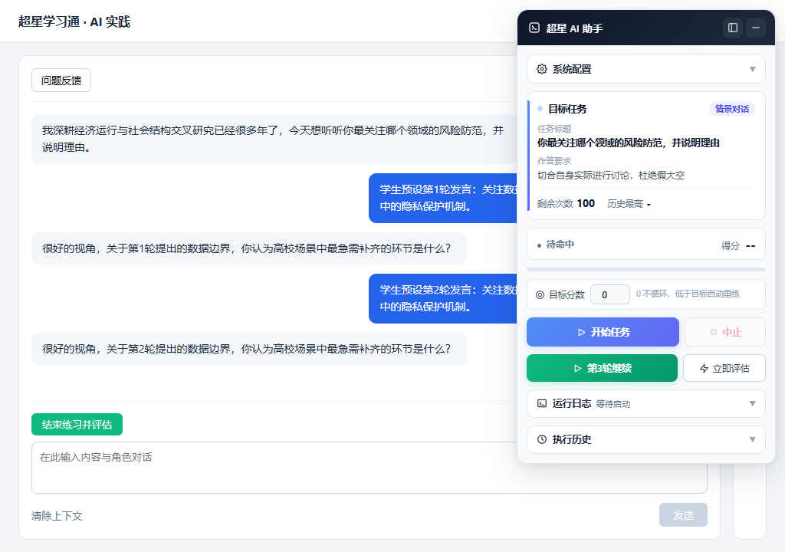
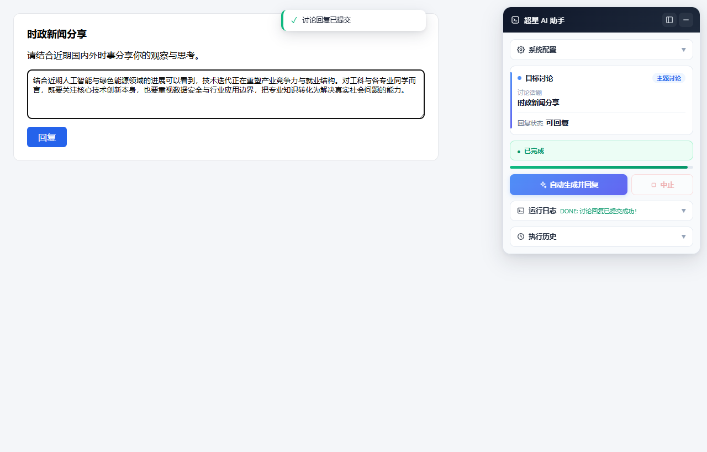
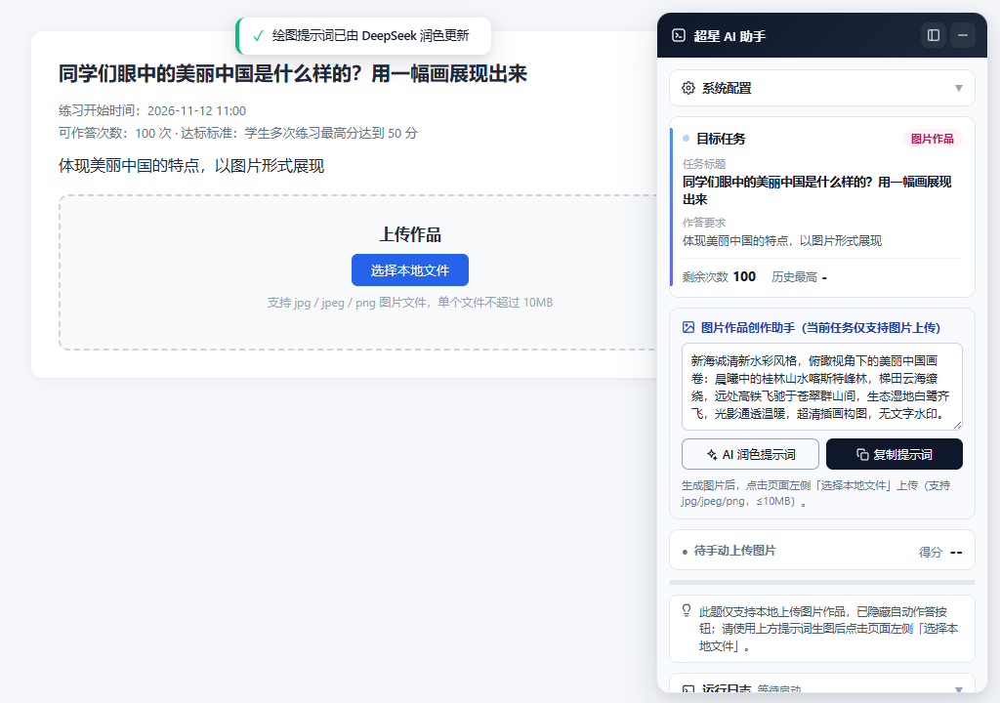

# 超星 AI 助手

> 面向 **Chrome / Edge** 浏览器的超星学习通自动化辅助扩展（v1.4.1）。支持 **AI 实践**（情景对话 / 文档作品 / 代码实践 / AI 思维阶梯）、**主题讨论** 自动作答、**整门课批量扫描调度**，以及按评估反馈 **自动重试冲分**。

> [!IMPORTANT]
> **安装前必看**：下载扩展压缩包解压或 `git clone` 后，浏览器加载扩展程序时**必须选择解压目录内的 `plug-core` 文件夹**，不要直接选择外层目录（否则会提示找不到 `manifest.json`）。

---

## ✨ 功能一览

| 功能模块 | 说明 |
|---|---|
| **整门课批量调度** | 一键扫描新版 `任务中心` / 旧版活动列表；自动校验 AI 实践 `load-data` 达标分数与主题讨论个人回复记录，区分 `已完成`、`已结束`、`未达标`、`需传图` |
| **AI 实践全自动** | 自动读取题目要求、角色设定与已聊轮次；多轮对话后提交并展示四维度 **评估结果摘要卡** |
| **目标分数自动冲分** | 设定目标分（如 `90`），未达标自动触发「重新练习」并读取上轮评价的 **低分项 / 不足 / 建议** 持续改进 |
| **断点续聊 / 立即评估** | 半途停止或手工聊过几轮时，自动显示 `从第N轮继续` 与 `立即评估` |
| **主题讨论自动回复** | 兼容新版 `groupweb` v3 与旧版讨论页，支持 `短·150字` / `中·300字` / `长·500字` 三档长度与防重发提示 |
| **图片作品提示词助手** | 遇到仅限上传图片（`jpg/jpeg/png`）的实践题时自动隐藏误触提交按钮，提供 **AI 润色绘图提示词** 与一键复制 |
| **DeepSeek V4 & 动态模型** | 填入 Key 后自动通过官方 `GET /models` 同步实时可用模型列表（支持点击 `↻` 手动刷新，自带 6 小时缓存与离线兜底），并按模型能力联动思考强度与 Token / 费用统计 |

---

## 📖 新手初次使用图文教程（小白 3 分钟上手）

### 第 1 步：下载代码并安装扩展（Chrome / Edge 通用）

1. **获取扩展文件**（三选一，新手推荐方式 A）：
   - **方式 A（推荐，免 Git / 最省心）**：前往 [GitHub Releases 最新版页面](https://github.com/limingjing6666/chaoxing-ai-task-helper/releases/latest) 下载 `chaoxing-ai-helper-v1.4.1.zip`，**右键解压到一个固定文件夹**（注意不要删掉解压后的文件夹，也不要直接拖未解压的 `.zip`）。
   - **方式 B（下载源码包）**：点击本仓库右上角绿色 **`Code`** 按钮 → **`Download ZIP`**，同样右键解压到固定目录。
   - **方式 C（会用 Git）**：执行 `git clone https://github.com/limingjing6666/chaoxing-ai-task-helper.git`
2. **打开浏览器的扩展管理页**：
   - **Edge 浏览器**：地址栏输入 `edge://extensions/` 回车
   - **Chrome 浏览器**：地址栏输入 `chrome://extensions/` 回车
3. **打开「开发者模式」**：在页面右上角（或左侧边栏）把 **开发者模式 / 开发人员模式** 开关拨到打开状态。
4. **加载 `plug-core` 文件夹**：点击新出现的 **`加载未打包的扩展程序`** / **`加载已解压的扩展程序`**（Edge 为 **`加载解压缩的扩展`**），在弹出的选择窗口中**双击进入刚才解压的文件夹，点选里面的 `plug-core` 子文件夹**，点击「选择文件夹」。
5. 看到列表中出现 **`超星AI助手 1.4.0`** 且右下角开关为蓝色开启状态，即安装成功！

> 💡 **后续更新怎么生效？** 拉取新代码或修改过 `plug-core` 文件后，只需回到扩展管理页点击 **`超星AI助手`** 卡片上的 **↻ 重新加载** 按钮，再刷新超星网页即可。

---

### 第 2 步：申请 DeepSeek API Key（约 1 分钟）

本插件通过官方接口调用 DeepSeek AI，初次使用需要准备一个密钥：

1. 打开 [platform.deepseek.com](https://platform.deepseek.com) 注册并登录。
2. 在左侧菜单进入 **API Keys**，点击 **创建 API key**（名称可填 `超星助手`）。
3. 复制生成的密钥（以 `sk-` 开头）。**注意**：弹窗关闭后将无法再次查看完整 Key，请先粘贴保存好；确保账户有少量可用余额即可（日常完成一门课的费用通常仅几分钱）。

> 🔒 **隐私说明**：API Key 仅保存在你自己浏览器的本地存储中，只直接请求你在配置中填写的接口地址，不经过任何第三方中转。

---

### 第 3 步：首次填入 Key 并测试连接

1. 登录超星学习通，打开任意课程的 **任务中心** 或具体 **AI 实践 / 主题讨论** 页面，右侧会自动浮出 **超星 AI 助手** 控制面板。
2. 首次尚未配置密钥时，面板会自动展开 **`系统配置`** 并提示 **`首次使用请填写 DeepSeek API Key（自动保存）`**：

3. 将 `sk-` 开头的密钥粘贴到 **`API Key`** 输入框，默认模型 **`deepseek-flash (V4.1-Flash)`**、对话轮数 **`5`**、间隔 **`3` 秒** 已经设为推荐默认值；输入后会自动保存（右上角出现绿色 **`✓ 已自动保存`**）并自动通过官方 `/models` 接口拉取当前可用模型（也可随时点击模型框旁的 **`↻`** 按钮手动刷新）。
4. 如需切换 **思考模式 (DeepSeek V4)**、**对话风格**、**补充要求** 或 **讨论回复字数**，点击 **`高级参数（接口 / 思考 / 风格 / 字数）`** 即可展开调整。
5. 点击 **`测试连接`**，页面顶部弹出绿色 **`✓ 连接成功`** 提示即表示可正常使用：

---

### 第 4 步：整门课一键批量扫描与自动完成（推荐）

最省心的用法是在课程首页直接扫描整门课：

1. 进入课程主页（支持新版 **泛雅任务中心** `fanyav3` 与旧版课程活动列表页），面板会自动切换到 **`课程任务批量调度`**。
2. 点击黑色按钮 **`扫描任务`**（已扫描过的页面显示 **`重新扫描`**）。插件会核对后台真实的 **`AI 实践达标成绩`** 与 **`主题讨论个人回复记录`**（即使超星页面按钮仍显示「去完成」，只要你其实已完成也会精准标绿）：
   - 🟢 **`已完成 · xx分` / `已完成`**：已达标或已回复过，默认取消勾选不重复做；
   - ⚪ **`已结束`**：活动已过截止时间，自动跳过；
   - 🟠 **`AI对话` / `主题讨论` / `文件` / `代码` / `阶梯`**：待完成项，默认自动勾选；
   - 🔴 **`需传图`**：仅支持上传图片的作品题，无法全自动作答，默认跳过；
   - 🟡 **`未达标 · xx分`**：做过但得分低于及格线，默认保持勾选方便重练达标。

3. 保持勾选 **`批量时自动开始 AI 实践（免逐题确认）`**，点击底部的 **`批量执行`** 按钮，插件会自动依次打开每个选中任务、作答提交并跳转下一题。执行过程中可随时点 **暂停 / 中止**。

---

### 第 5 步：各类单题使用演示

#### 1. 单个 AI 实践对话 + 自动评估冲分
打开单个 AI 实践任务页面，点击 **`开始任务`** 即可全自动完成对话并提交评估。如果希望刷到高分，可在按钮上方的 **`目标分数`** 中填入理想分数（如 `90`）：得分低于目标时，插件会自动点击页面上的「重新练习」，并结合上次 **`评估结果摘要`** 中的不足与建议重新对话。

#### 2. 半途断点续聊 / 手动聊了几轮直接评估
如果你已经手动发送过几条消息，或中途点击了 **`中止`**，面板会自动识别已完成的轮数并弹出绿色 **`从第N轮继续`** 按钮；若觉得对话内容已经够充分，也可以直接点 **`立即评估`** 结束练习并打分。

#### 3. 主题讨论页自动回复
打开任意超星 **主题讨论** 页面，面板会自动识别话题正文与可回复状态；点击 **`自动生成并回复`**，AI 会结合你设定的字数档位（`短·150字` / `中·300字` / `长·500字`）生成贴合主题的发言并自动填写提交。

#### 4. 纯图片上传题（防误触 + 提示词助手）
遇到只允许上传 `.jpg / .jpeg / .png` 的实践任务时，插件会识别为 **`图片作品`** 并隐藏自动作答按钮，避免误交白卷；你可以直接点 **`AI 润色提示词`** 让 DeepSeek 帮你扩写成更具体的画面描述，再点击 **`复制提示词`** 到画图工具生成图片后点击页面左侧 **`选择本地文件`** 上传。

---

## ⚙ 配置项与界面说明

| 设置位置 | 选项 | 说明与建议 |
|---|---|---|
| **基础配置** | `配置方案` | 支持点击 **`+` / `-`** 新建或删除多套预设方案，方便在多个模型或课程风格间切换 |
| **基础配置** | `API Key` | 填入 DeepSeek 官方或中转接口密钥（支持右侧小眼睛切换明文查看） |
| **基础配置** | `模型` | 默认自动从官方 `GET /models` 拉取并更新列表（可点右侧 **`↻`** 手动刷新）；`deepseek-flash` 速度快成本极低（推荐），`deepseek-v4-pro` 深度分析更强 |
| **基础配置** | `轮数 / 间隔(s)` | 建议 `5～8` 轮、间隔 `3` 秒以上；对话轮数过少可能影响得分 |
| **高级参数** | `接口地址` | 默认 `https://api.deepseek.com`；更换为第三方兼容中转地址后点击 **`↻`** 可同步对方支持的模型列表 |
| **高级参数** | `思考模式 (DeepSeek V4)` | 默认 **`关闭（快速直出 · 推荐）`**；可选深度随所选模型的官方 `effort.supported_levels` 动态显示（如 `low` / `high` / `max`） |
| **高级参数** | `对话风格` | **专业均衡**（通用）、**探究追问**（偏思辨追问）、**落地实战**（偏案例与执行）、**精准高效**（80 字内简练输出） |
| **高级参数** | `补充要求（可选）` | 附加个性化要求（例如：`口语化一点`、`结合软件工程专业举例`），不会覆盖题目本身的角色设定 |
| **高级参数** | `讨论回复字数` | **`短 · 150字`** / **`中 · 300字`** / **`长 · 500字`** |

- **面板自由停靠与收纳**：可拖动顶部黑色标题栏调整位置（双击标题栏恢复默认位置），点击右上角停靠图标可在 **页面右侧 / 左侧** 一键切换，点 **`-`** 收起为不遮挡超星顶部导航栏的轻量悬浮图标。
- **用量透明统计**：配置区底部实时展示 **本次** 与 **累计** Token 消耗及按 DeepSeek 分时段阶梯价估算的人民币参考费用。

---

## ❓ 小白常见问题排查

<b>1. 加载扩展时报错「无法加载清单 / Manifest file is missing」怎么办？</b>

说明选错了文件夹层级。请确认选中的是包含 `manifest.json` 的内层 **`plug-core`** 文件夹，而不是外层整个项目目录；另外压缩包必须**完全解压后再选择**。

<b>2. 打开超星网页后，右侧没有出现「超星 AI 助手」面板？</b>

1. 到 `chrome://extensions/` 或 `edge://extensions/` 确认扩展开关已开启。
2. 面板仅在 **课程任务中心 / 活动列表页**、**AI 实践作答页**、**主题讨论详情页** 自动出现，纯看视频章节页不会弹出。
3. 若刚刚重新加载过扩展，请按 `F5` **刷新超星网页**（否则旧标签页可能触发 `Extension context invalidated` 上下文失效报错）。

<b>3. 课程页面上已经做完的任务，为什么批量列表里显示状态跟上次不一样？</b>

插件会记住最近 1 小时内的扫描缓存以便快速打开，但当你在其他设备提交过任务或重新加载扩展后，点击一次 **`扫描任务` / `重新扫描`** 就会重新请求超星实时接口刷新全部状态。

<b>4. 点击「测试连接」失败或提示额度不足？</b>

- 检查 `API Key` 首尾是否多粘贴了空格，以及 `sk-` 是否完整。
- 登录 [platform.deepseek.com](https://platform.deepseek.com) 检查账户是否有可用余额（新号通常需要充值最低额度或领取可用资源包后接口才能返回响应）。
- 若使用自定义代理接口地址，请确保地址格式正确（例如以 `https://` 开头，无需多余斜杠）。

<b>5. 提示「作答次数已用尽」或「当前任务已提交」？</b>

- 若剩余次数为 `0`，说明教师后台设置已无重做机会，需要联系任课教师增加练习次数。
- 若页面停留在已评估结果页而你希望重刷一次，可直接点面板上的 **`开始任务`**（新版页面会自动触发「重新练习」开启新一轮），或设定更高的 **`目标分数`**。

---

## ⚠ 免责声明

本工具仅作学习交流与浏览器辅助工具研究用途。使用前请遵守所在学校与课程平台的相关规范，由此产生的一切账号及学业结果由使用者自行承担。
